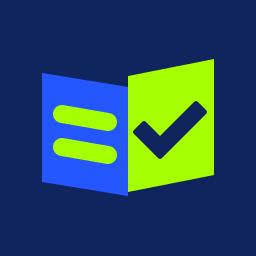
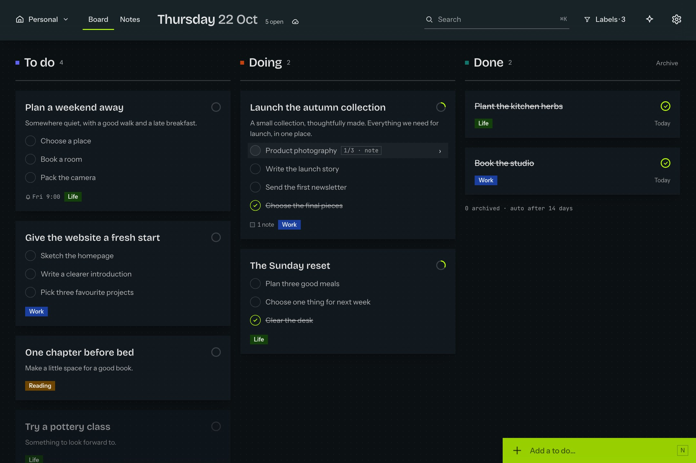
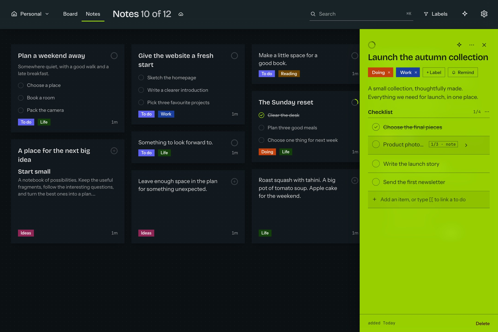
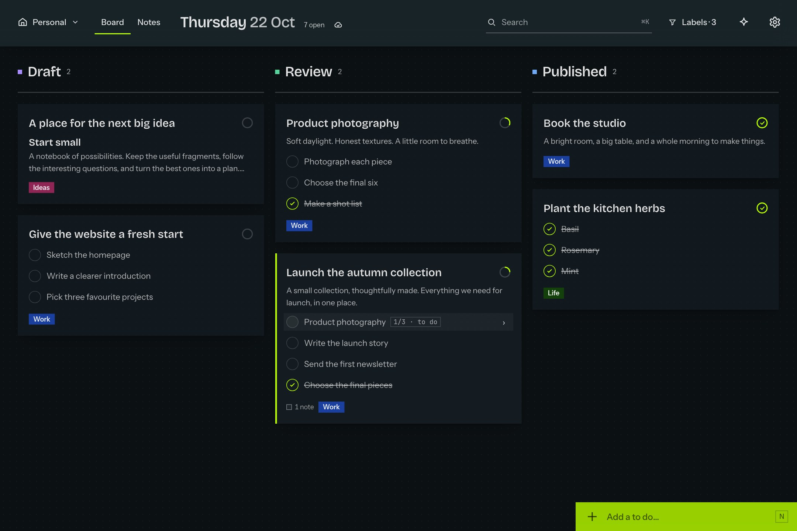
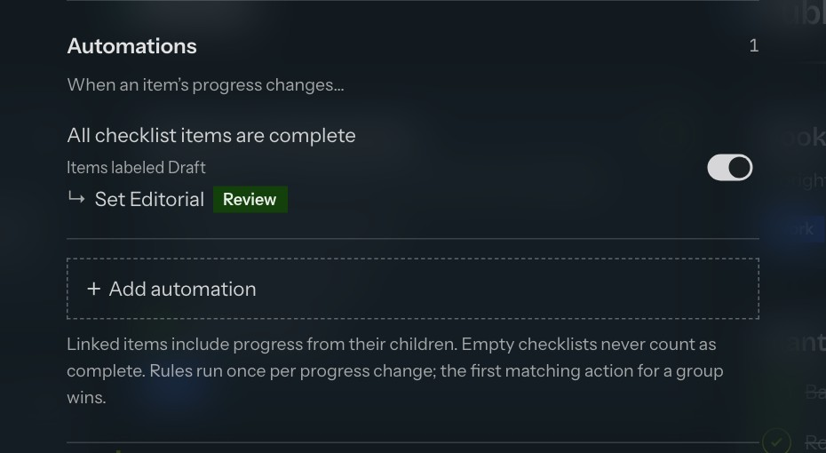
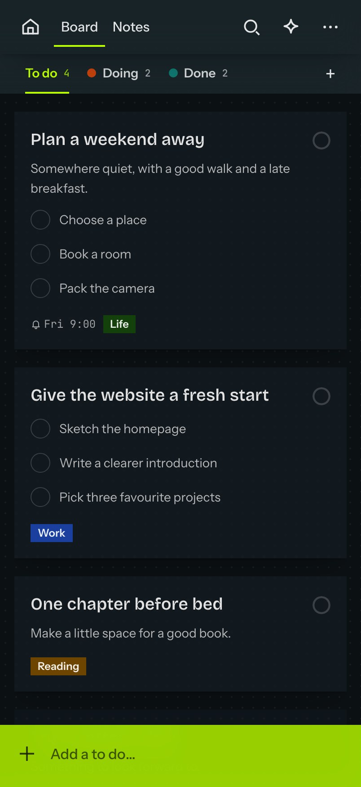
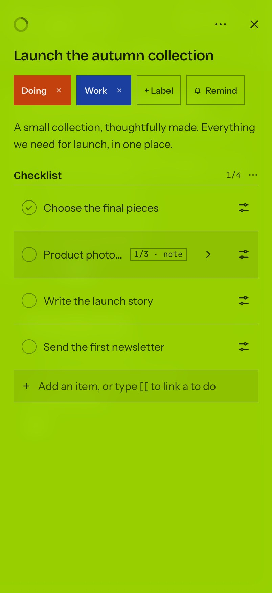
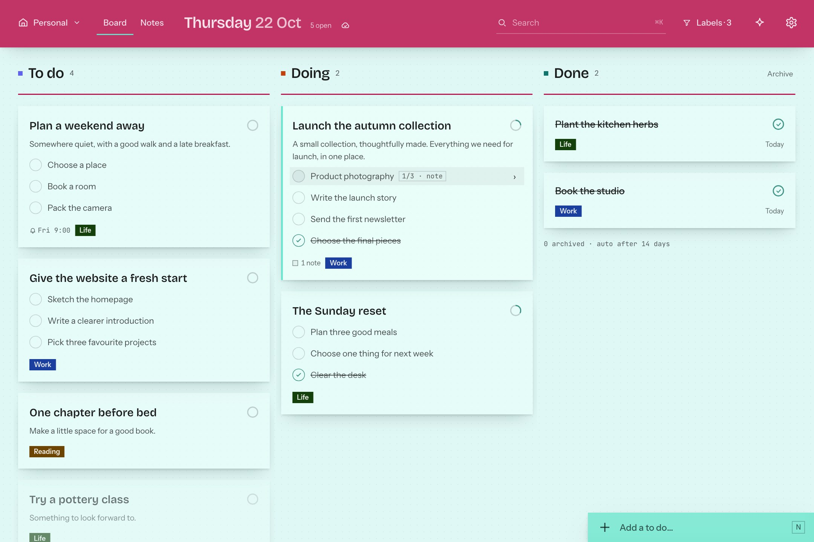
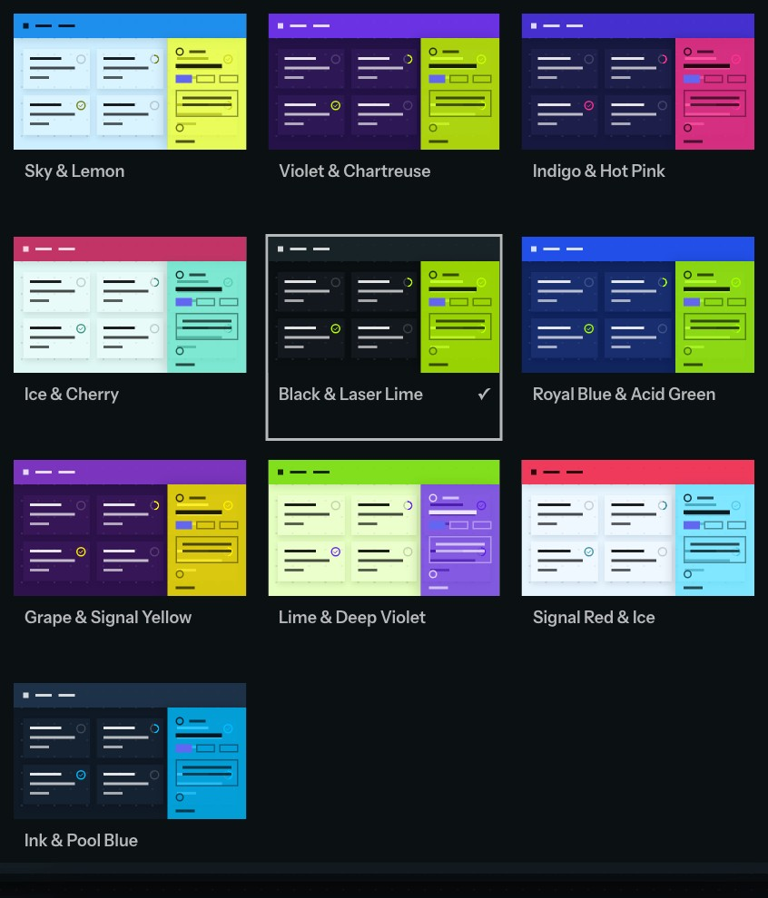

<p align="center">
  
</p>

<h1 align="center">Todos</h1>

<p align="center"><strong>Make room for what matters.</strong></p>

<p align="center">
  Notes, checklists and a clear path from idea to done.<br>
  A self-hosted workspace that feels at home on your phone and your desktop.
</p>

<p align="center">
  <a href="#a-thought-a-plan-a-little-progress">Features</a> ·
  <a href="#built-around-your-way-of-working">Custom workflows</a> ·
  <a href="#connect-the-rest-of-your-world">Integrations</a> ·
  <a href="#run-it-yourself">Get started</a> ·
  <a href="docs/development.md">Developer guide</a>
</p>



<p align="center"><sub>Your next step, the work in progress, and the things you finished. All in one view.</sub></p>

## A thought, a plan, a little progress

Some things start as a sentence. Others need a checklist, a few reference files, and a plan. Todos gives them a home and lets them grow. Tap a note's corner circle to put it in To do, then tap again when it is done. New notes and to dos appear at the top, where you can find them.

| For the things you need to… | Todos helps you… |
| --- | --- |
| **Get out of your head** | Capture a quick note, or set up optional [Apple Shortcuts](docs/development.md#siri-iphone-and-apple-watch) to dictate a thought or save a link from the share sheet. |
| **Put into perspective** | Switch between a visual board and a collection of notes. Search the words you remember, filter by labels, and turn labels into board columns. |
| **Break into steps** | Add checklists, or link a whole note as a checklist item. Keep the detail close without losing the bigger picture. |
| **Come back to** | Set a reminder, choose a repeating schedule, and receive notifications through [ntfy](https://ntfy.sh). |
| **Keep working on** | Edit your cached workspace offline. Changes wait on your device and sync when the connection returns. |
| **Make your own** | Choose from ten colour palettes and eight background patterns. Your appearance follows your account across rooms and devices. |



### Everything a task needs, right where you need it

Write in Markdown. Paste a screenshot, attach a file, or keep useful links beside the work. Open a linked note to explore a smaller part of the plan, then follow the breadcrumb back. Changes save as you type; Undo gives you room to change your mind.

## Built around your way of working

Start with **To do → Doing → Done**. When your work needs a different rhythm, create your own flow: **Draft → Review → Published**, for example. Choose the stages, decide which one means finished, and use them as board columns.



- **Flows that fit the work.** Build separate stages for writing, planning, or any process with a beginning and an end. Reopening a finished note returns it to its previous stage.
- **Labels that keep work moving.** Use labels as board columns. Keep one priority at a time with an exclusive group. Add, remove or change labels as a checklist progresses: completing a Draft can move it to Review, while opening a note can clear its Unread label. Preview saved rules on sample notes first.
- **Space for different parts of life.** Keep your personal room private and create shared rooms for work you do with others. Each room has its own notes, labels and board.
- **A simple way to share.** Create a view-only link when someone needs to see the board without editing it. Revoke or replace the link when you choose.



<p align="center"><sub>Labels can take action: this Draft rule moves work to Review as soon as its checklist is complete.</sub></p>

## A proper home on your phone

Install Todos as a web app and keep it beside the tools you use every day. Swipe between board columns and notes, press and hold to rearrange cards, and open a note in a full-screen editor. On desktop, use keyboard shortcuts, drag and drop, and an editor that stays beside your board.

<p align="center">
  
  &nbsp;&nbsp;
  
</p>

<details>
<summary><strong>A different mood, the same workspace</strong></summary>

Ten palettes and eight independent patterns let you choose a space that feels like yours. Here is the same board in Ice & Cherry.





</details>

## Connect the rest of your world

Todos can be the place work arrives, as well as the place you organise it.

| Connection | What it opens up |
| --- | --- |
| **Scripts and services** | Use the [HTTP API](shared/agents.md) to capture notes, find work, update progress, attach files, and set reminders. A stable capture key lets a script retry without creating duplicates. |
| **Browser automation** | The [browser API](docs/development.md#windowkanban-143) exposes the same note and checklist actions as the interface. Build small helpers around the way you work. |
| **AI assistance** | Connect an optional compatible model server, including a local model, to help choose priorities or break an idea into steps. Review suggestions before applying them; additions have Undo. |
| **Voice and sharing** | On a macOS server, set up [Apple Shortcuts](docs/development.md#siri-iphone-and-apple-watch) for Siri capture and the share sheet. A separate compatible model server adds richer spoken commands, including changes to existing notes. |
| **A connected agent** | The optional [Sherlock connection](docs/development.md#sherlock-handoff) hands a note to a configured Slack agent and brings its reply back to the note. |
| **Bot workspaces** | Give Sherlock, Claw and Lurch separate rooms for their tasks and recurring jobs. Ask a bot on a card, then read its reply on that same card. Bot tokens and webhook settings stay in the server's private data directory. |

The [developer guide](docs/development.md) covers the APIs, sync model and integration setup. The [agent guide](shared/agents.md) includes authenticated request examples for tools that work outside the browser.

## Your server. Your workspace.

Run Todos on your own infrastructure. The app server keeps the shared state and attachments on disk; devices keep a local cache for offline use. Export a board as JSON, or bring in notes and checklists from Markdown and text.

The core app runs without an AI service. Email sign-in, [ntfy notifications](https://ntfy.sh), [Apple Shortcuts](docs/development.md#siri-iphone-and-apple-watch) and the assistant have their own optional setup. For Siri capture, host Todos on macOS, set `APP_URL` to an address your devices can reach, generate signed shortcuts in Settings, and install them on your Apple devices.

## Run it yourself

You need [Node.js](https://nodejs.org/en) 22 or newer, npm, and access to this repository.

```bash
git clone https://github.com/claudiucelfilip/todos.git
cd todos
npm ci
npm run build
TODOS_USER=you TODOS_PASS='replace-with-a-strong-password' npm start
```

Open [Todos locally](http://localhost:8094) and sign in with the credentials you set above. The server creates its data directory on first start. Keep that directory when upgrading, and use HTTPS when hosting the app beyond your own machine.

For frontend development, run `npm run dev`. For deployment, account setup, optional integrations and checks, see the [developer guide](docs/development.md).

---

Built with [React](https://reactjs.org/), [TypeScript](https://www.typescriptlang.org/), [Vite](https://vite.dev) and a [Node.js](https://nodejs.org/en) server. Installable as a Progressive Web App, with an offline cache on each device.

<sub>All screenshots show the running app with sample content. See the [capture notes](docs/screenshots/README.md) to reproduce them.</sub>
